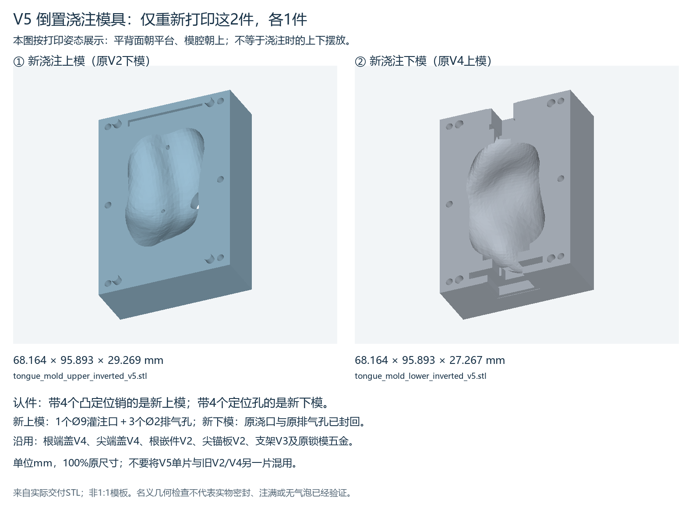

# 拉索驱动软体舌头

**Tendon-driven Soft Tongue · SOFA / SofaPython3 / Arduino / MG90S**

用双轴摇杆控制舵机收放拉索，使舌根固定的硅胶舌体产生弯曲。本项目记录了交互仿真、三维模具设计、3D 打印、硅胶浇注和桌面电控原型的实现过程。

仿真与实体目前是两条独立的工作链路：SOFA 中用弹性目标驱动舌体，不是已经标定的四拉索物理模型；Arduino 负责实体的摇杆输入与舵机输出，二者尚未联动。

## 项目内容

- **可交互仿真**：基于 SOFA 官方口腔网格，生成舌体四面体有限元模型，固定舌根，通过渐变权重的弹性目标实现自动循环与键盘控制。
- **模具与成型**：保留舌体几何来源，设计成型模具、舌根嵌件和舌尖锚板，使用 3D 打印模具浇注铂金硅胶。V5 调整了倒置浇注时的灌注口和排气孔。
- **四拉索控制方案**：上下、左右各一对拉索。摇杆给定方向后，一侧收线、对侧放线，斜推同时作用于两对；支持死区、平滑回中、按键启用和超时回中锁定。




## 实际进度

| 模块 | 当前状态 |
|---|---|
| SOFA 场景及键盘交互 | 已运行，已修正上下方向和舌根固定区域 |
| 3D 打印与硅胶舌体 | 已完成多轮打印、试装和浇注，形成桌面样机 |
| Arduino 单舵机控制 | 已完成调试 |
| 四舵机结构安装 | 已安装到木质底板 |
| 四舵机带载联调 | 未确认通过；电源、保险和四路机械方向仍需逐项核对 |
| ROS 2 串口控制 | 规划中，本仓库没有已完成的 ROS 2 节点 |
| 实体位置闭环与材料标定 | 未实现 |


## 系统结构

```text
交互仿真：键盘 / 自动轨迹 → SofaPython3 控制器 → FEM 舌体 → 显示

实体控制：双轴摇杆 → Arduino UNO R3 → 4 路舵机信号
                                      ↓
                   上下 / 左右 4 根拉索 → 硅胶舌体
                                      ↓
                                舌根固定在底座
```

## 目录

```text
.
├── tongue_motion.py          # SOFA 场景与控制器
├── START_TONGUE.cmd          # Windows 启动入口
├── assets/                   # SOFA 原始网格、纹理、来源与许可证
├── firmware/
│   ├── tongue_controller_final/  # 当前四舵机程序
│   └── single_servo_load_test/   # 原单舵机程序
├── hardware_prototype/
│   ├── PRINT_INDEX.md        # 只从这里选择打印文件
│   ├── cad/                  # 参数化网格建模与核查源码
│   ├── revision_v5/          # 当前上下模及工程示意
│   └── ...                   # 为重建保留的旧版输入，不是打印推荐
├── docs/                     # 仿真、接线、版本、来源和验证记录
├── tests/                    # 不连接硬件的控制逻辑测试
└── tools/                    # 便携启动与仓库完整性检查
```

## 运行仿真

已使用的环境是 **Windows、SOFA 25.12、SofaPython3 和与该插件匹配的 Python 3.12**。SOFA 的 Python 场景通常不是双击普通 Python 解释器就能运行的脚本。

```powershell
python tools/launch_sofa.py --sofa-dir "D:\SOFA\SOFA_v25.12.00_Win64" --python-dir "D:\SOFA\Python312"
```

上面的盘符只是参数示例，不是写死的依赖。也可以设定 `SOFA_ROOT`、`SOFA_PYTHON_ROOT` 后双击 `START_TONGUE.cmd`。完整要求和常见问题见 [仿真运行说明](docs/SIMULATION.md)。

先点击三维画面取得焦点；Qt 界面可能需要按住 Ctrl 转交字母键给场景。

| 按键 | 功能 |
|---|---|
| `W` / `S` | 舌尖上 / 下 |
| `A` / `D` | 左 / 右 |
| `E` / `Q` | 前伸 / 后缩，仅仿真有此命令轴 |
| `X` 或 `0` | 回中 |
| 空格 | 自动 / 手动切换，具体转发受 GUI 影响，可在 `TongueControl` 中切换 |

## Arduino 程序

Arduino IDE 打开 [tongue_controller_final.ino](firmware/tongue_controller_final/tongue_controller_final.ino)，选择 Arduino Uno 和对应端口；使用官方 Servo 库。

| 通道 | 上 | 下 | 左 | 右 |
|---|---|---|---|---|
| UNO 信号引脚 | D3 | D5 | D9 | D10 |

摇杆 `VRx → A0`、`VRy → A1`、`SW → D2`、`VCC → UNO 5V`、`GND → UNO GND`。舵机由独立低压电源供电，与 UNO 共地。

**首次启用必须卸下拉索。** 摇杆居中开机后，按住摇杆帽约 1 秒并松开，等待 L 灯常亮。默认收放命令范围仅为 ±3°；各路收线正负号必须按实物安装方向确定，不能用接反电源来改变转向。详见 [接线与启用](docs/WIRING.md)。

## 图纸与制造

打印清单见 [PRINT_INDEX.md](hardware_prototype/PRINT_INDEX.md)。当前完整组合是 **V5 上下模 + V4 两端盖 + V2 根嵌件与尖锚板 + V3 L 支架**。不要混用新旧两片模具。

CAD 目录中的“建模”是 Python 参数化三角网格和布尔运算，不是 Fusion 原生 `.f3d` 或 STEP 特征树。可打印 STL 和建模源码均保留，依赖见 [CAD 说明](docs/CAD.md)。


不接硬件的检查命令：

```text
python tools/check_repository.py
python -m unittest discover -s tests -v
```

检查范围及结果见 [验证记录](docs/VALIDATION.md)。

## 来源

- 口腔、牙齿和舌体网格及纹理：[SOFA Dentistry_Haptics](https://github.com/sofa-framework/sofa/tree/4d6c2b8e8cd976836c5e071e9db14f1963d84cc9/examples/Tutorials/StepByStep/Dentistry_Haptics)。
- 拉索与内嵌软管的原理参考：Nobutsuna Endo, 2021, [Deformation model and experimental evaluation of a contractable and bendable wire-pulling mechanism with embedded soft tubes for a robotic tongue](https://doi.org/10.1186/s40648-021-00193-6)。

