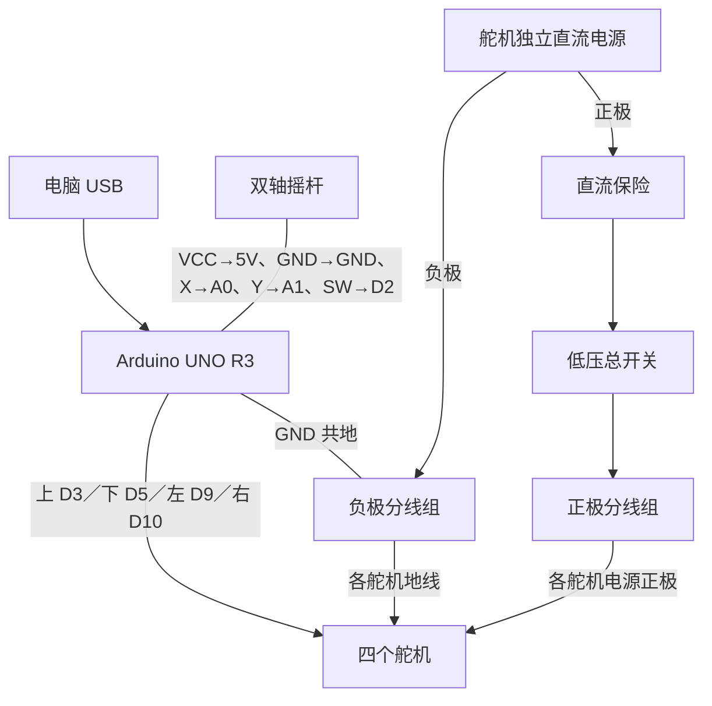

# 四舵机软体舌头：接线、装配和操作

使用 Arduino UNO R3、一个带 SW 按键的双轴摇杆、四个位置型舵机。`tongue_controller_final.ino` 是本版程序，和早期单舵机程序、自动画圈版分开。本版手动操作，不会自动画圈。

## 1. 断电接线

先拔掉外部适配器和 UNO 的 USB，四根钢索先不挂舵盘。按端子丝印确认引脚和极性，不只凭颜色或插头顺序。

| 顺序 | 从哪里 | 到哪里 |
|---|---|---|
| 1 | 适配器低压正极 | 匹配线材的直流保险 → 低压总开关 → 正极分线组 |
| 2 | 适配器低压负极 | 负极分线组；再由负极分线组接 UNO 的 GND |
| 3 | 四只舵机各自的电源正极、地线 | 四条正极分别接正极分线组，四条地线分别接负极分线组 |
| 4 | 上、下、左、右舵机各自的信号线 | 分别接 UNO 的 D3、D5、D9、D10 |
| 5 | 摇杆 VCC、GND、VRx、VRy、SW | 分别接 UNO 的 5V、GND、A0、A1、D2 |
| 6 | UNO USB | 接电脑供电和上传；此时舵机低压总开关保持关 |

- 正、负分线组必须彼此隔离。无电容时，正极组至少容纳电源和四只舵机共 5 个接线位；负极组再加 UNO GND，共 6 位。若沿用跨接母线的电容，正负各再多一个接线位，电解电容极性和耐压必须正确。端子和导线按实际电流选，别把两根线硬塞到一个只允许单线的夹口。
- **舵机的电源正极不进 UNO 的 5V、VIN 或圆插孔，不让舵机动力走面包板或普通细杜邦线。** UNO 的 5V 在本图只供摇杆。UNO 与舵机电源只通过 GND 共地，信号线另接。参见 [Arduino 舵机供电说明](https://support.arduino.cc/hc/en-us/articles/360017053760-Troubleshoot-servo-motors)。
- 只接适配器的低压侧，不改装市电侧。原 5V/5A 适配器能否使用，须核对四只实物舵机允许的电压和组合峰值电流，以及主线、分线端子、低压开关和保险的额定值。不能用单机 2A 方案直接推断四机配置，也不能盲目换更大的保险。关断开关要能在不跨过舵盘或钢索的情况下够到。

## 2. 上传后定方向和中位，再挂索

1. 舵机电源仍关闭，四索不挂。Arduino IDE 打开同目录的 `tongue_controller_final.ino`，选 **Arduino Uno** 和正确端口，使用官方 **Servo** 库，点击上传。开机约一秒不要碰摇杆，程序会读中位。按需打开 115200 波特率串口监视器；打开串口可能重启 UNO，所以不要在带载时为看状态临时打开。发送小写 `p` 可看状态，`cmd` 是命令值，不是实际角度反馈。
2. 手和零件让开舵盘，接通已确认合适的舵机电源。摇杆居中，按住摇杆帽约 1 秒后松手；程序给四只舵机中位信号，再等待约 0.6 秒。板上 **L 灯常亮**才进入摇杆控制。初次启用时舵机可能先转到中位，所以四根索还不能挂。
3. 中位确定后，关舵机电源并拔 USB，装舵盘并用原配中央螺钉固定。**每只舵臂在中位分别与自己的来索近似垂直**。先用较靠近轴的可用孔，别挂中央螺丝。上电启用时仍不挂索，逐个小推方向：该路舵盘孔应远离舌根，对侧应靠近舌根。如果单只收放相反，改对应 `PULL_SIGN` 的 `+1/-1`；如果整个摇杆轴的物理方向相反，改对应 `INVERT_X` 或 `INVERT_Y`。所有改动和上传都在卸索、舵机动力关闭时做。
4. 回中后关闭动力、拔 USB。确认舌尖四个压套止挡承在固定牢靠的硬质锚板上，根部和底板锁牢。舌体自然放松，根侧每根索按标签穿到对应舵盘小孔，折回并用匹配压套固定。**只收掉明显松圈，不要把四根索预先绷紧。** 挂环长度定好后再剪短尾，按压套要求保留尾长。固定的是电线，四根会滑动的钢索不要扎在一起。

## 3. 正常操作

- **启用：**摇杆居中，长按约 1 秒再松手，等 L 灯常亮。插电、复位后不能直接推杆带动拉索；第一次启用仍可能驱动舵机到中位。
- **运动：**上推＝上收、下放；下推＝下收、上放；左推＝左收、右放；右推＝右收、左放。松开摇杆＝四路回到各自中位。先小幅、单方向操作；斜推会同时作用于两对，待单向和机械行程合适后再用。
- **锁定：**运行中短按摇杆帽，程序平滑回中并锁定。偏杆持续约 5 秒也会回中锁定，重新启用要先居中。锁定后仍可能保持中位信号，**不切断舵机动力**。
- **立即停机：**如果钢索绷紧但不动、舵机持续嗡响或出现卡碰、滑脱，马上关独立舵机电源，不等软件回中。随后拔 USB，再解除负载；断电不保证减速齿轮会立刻放线。

## 4. 配置的位置和边界

开头的四个数组都按 **上、下、左、右** 排列。`NEUTRAL` 是中位命令；`PULL_SIGN` 是该舵机收线时角度加还是减；`PULL_DEG`、`RELEASE_DEG` 分别是收线和放线命令上限。默认 ±3° 命令只是保守起点，不是实测行程，也不保证任何一只舵机够力。对侧放线不足、支架碰撞、锚板或电源不匹配，不能靠调大角度解决。没有张力或电流传感器，这份程序不能检测堵转、断索或所有摇杆故障；实际限位以你的四路机械装配为准。

编译核对：Arduino CLI 1.5.1、AVR Boards 1.8.8、Arduino Uno (`arduino:avr:uno`) 编译成功，程序占 8,166 字节，静态 RAM 占 320 字节。未上传至开发板，未在实物上通电运行。
