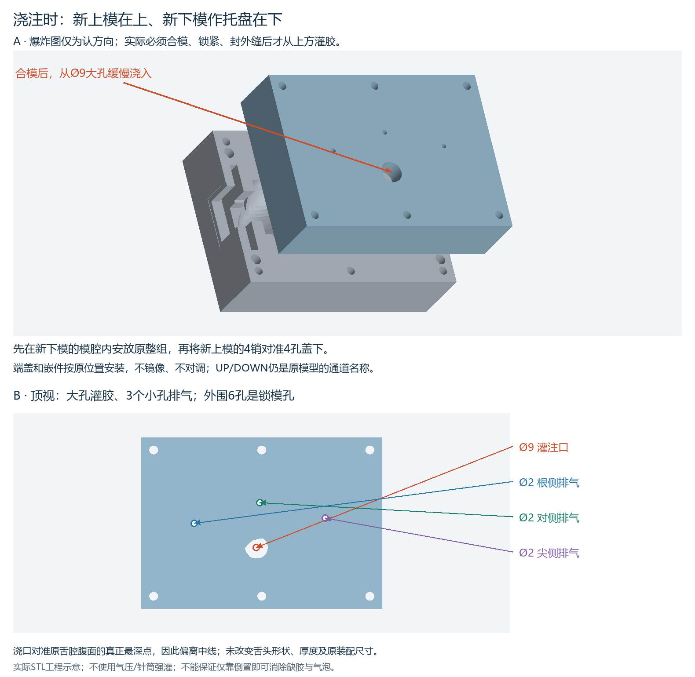
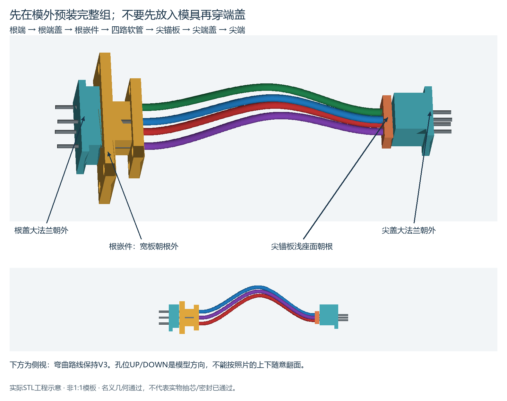

# 当前打印组合

单位为毫米；先读完各版本说明，再按 1:1 提交 STL。这里列出的 7 件是当前组合，不代表都要重新打印。仓库保留的其他旧模具只作为 CAD 重建输入。

| 角色 | 文件 | 数量 |
|---|---|---:|
| V5 上模 | [tongue_mold_upper_inverted_v5.stl](revision_v5/print/tongue_mold_upper_inverted_v5.stl) | 1 |
| V5 下模 | [tongue_mold_lower_inverted_v5.stl](revision_v5/print/tongue_mold_lower_inverted_v5.stl) | 1 |
| V4 根端盖 | [tongue_root_end_dam_v4.stl](revision_v4/print/tongue_root_end_dam_v4.stl) | 1 |
| V4 尖端盖 | [tongue_tip_end_dam_v4.stl](revision_v4/print/tongue_tip_end_dam_v4.stl) | 1 |
| V2 根嵌件 | [tongue_root_insert_v2.stl](stl/tongue_root_insert_v2.stl) | 1 |
| V2 尖锚板 | [tongue_tip_anchor_v2.stl](stl/tongue_tip_anchor_v2.stl) | 1 |
| V3 L 支架 | [tongue_root_bracket_v3.stl](revision_v3/print/tongue_root_bracket_v3.stl) | 1 |

V3 支架另有 [底孔 3 mm 变体](revision_v3/print/tongue_root_bracket_v3_base_3mm.stl)。它只替换支架底座安装孔，按实际螺钉选择，不能两款都作为必需件。

四个 MG90S 的商用支架与木板安装方式不是这 7 件的一部分，仓库也没有经过实物确认的通用四舵机一体架。不能用单舵机测试板冒充它。

## 浇注摆放

阅读 [V5 原始说明](revision_v5/README_CN.md)。上/下是浇注姿态，不是打印摆放姿态。新上模有 1 个大灌注口、3 个小排气口；与新下模配成一副，不与旧版单片混合。

软管用于导引钢索，留在硅胶内部；不通气，也不导电。整根弯钢棒在实物中出现过无法抽出的情况，已经不作为推荐装配步骤。当前采用管端短直针固定的方法；短针退出与软管畅通仍须在实际装配中核对。

导管弯曲模板和旧装配图是设计路线参考，不保证柔性软管会完全保持数字曲线。L 支架不放进模具；根嵌件、尖锚板和端盖才是模内相关件。

旧工艺中“整根弯钢棒抽芯”的步骤不能与当前方案混用。硅胶配比、固化条件按手上实际材料厂家说明执行，不根据旧采购清单猜牌号。

*该图用于辨认根盖、嵌件、导管和尖盖。灰色长芯棒是历史示意，不代表当前推荐使用卡住的弯钢棒。*
