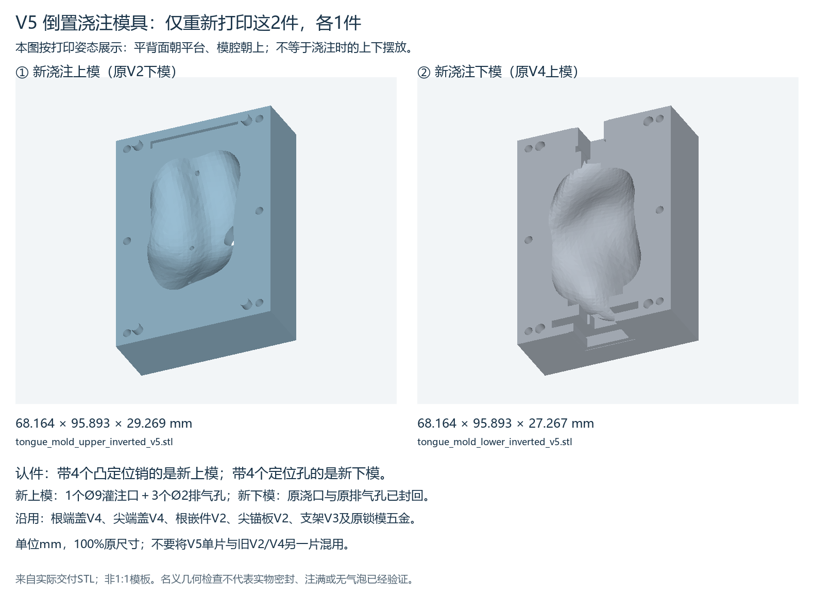
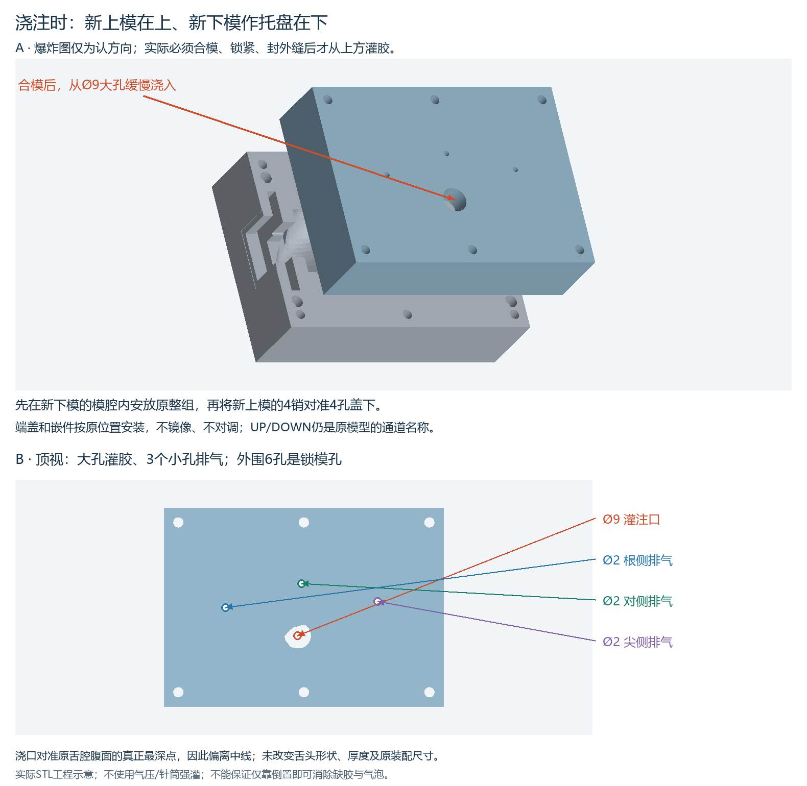

# V5：倒置浇注上下模（只改浇口、排气通道）

日期：2026-10-28。单位：毫米。该版是用户指定的进胶方向调整，不是舌头本体重设计。

## 1. 只需重新打印2件

| 交给打印店的文件 | 数量 | 外包尺寸，mm | 浇注时用途 |
|---|---:|---|---|
| `print/tongue_mold_upper_inverted_v5.stl` | 1 | 68.164 × 95.893 × 29.269 | 新上模，由旧V2下模改；保留4个凸定位销，新增浇口及排气 |
| `print/tongue_mold_lower_inverted_v5.stl` | 1 | 68.164 × 95.893 × 27.267 | 新下模，由旧V4上模改；保留开放装配槽及定位孔，封回原浇口及排气 |

尺寸含定位销。两片合模本体厚度仍约52.536 mm，不是两片外包高度之和，原M3×65锁模螺钉继续沿用。

上/下名称现在按**浇注时的摆放**定义；不要因打印平台上的摆放姿态再次改名。

## 2. 本次改动范围

1. 原V4上模的Ø9根侧浇口、两个Ø2尖侧排气通道封回，作为新下模。
2. 原V2下模新增垂直Ø9灌注口，作为新上模。中心对准原舌腔腹面绝对最深点：世界坐标x=9.710、z=36.691 mm。原模型不完全对称，所以孔偏离中线，不是画错了。
3. 新上模设3个Ø2排气孔：对侧深凹区、靠根侧、靠尖侧各一处。新孔均真正接通模腔，不是钻到另一片实体上的盲孔。
4. 不改变舌头轮廓、厚度、分型面、原嵌件口袋、开放装配槽、定位销/孔和6个锁模通孔。STL数值导出使用与旧V4相同的0.001 mm级微小共面面片整理，不属于重新设计尺寸。

新孔改变进胶及排气方向，但不是“注满、无气泡、嵌件包胶牢固”的保证。

## 3. 这些旧件全部沿用，不需要重买或重印

- 根端盖：`tongue_root_end_dam_v4.stl`对应实物。
- 尖端盖：`tongue_tip_end_dam_v4.stl`对应实物。
- 舌根嵌件：`tongue_root_insert_v2.stl`对应实物。
- 舌尖锚板：`tongue_tip_anchor_v2.stl`对应实物。
- L形支架：`tongue_root_bracket_v3.stl`对应实物；它不放进模具。
- 原6组M3锁模螺钉、垫片和螺母。
- 原导管、短直针及装配路线；本次没有恢复已经卡住的整根弯钢棒方案。

旧V2下模、旧V4上模本次均被V5对应新件替代。旧件可留作备用或对照，不必丢掉。不要将V5的一片与旧版另一片混合浇注，否则会多出或缺少通道。

## 4. 收货后和浇注时怎么摆放

1. 找到**没有凸定位销、带开放装配槽**的V5新下模，模腔朝上放桌上，它仍是原来放整组的托盘。
2. 按原方向放入根端盖、根嵌件、4根软管、尖锚板和尖端盖。端盖大法兰朝模具外；不得对调根尖件。保留当前短直针方法，软管中段不重新插入卡住的弯棒。
3. 检查所有件坐实，不翘起、不夹管。原UP/DOWN通道名称保持不变，不因倒置而换孔。
4. 拿**带4个凸定位销**的V5新上模，模腔向下、平背面向上，让4销对准新下模的4孔，手力轻合。合不拢就停，不靠螺钉强拉。
5. 先完成一次干装再拆开检查。确认没有移位后，重新合模，装原6组锁模螺钉、垫片和螺母，交叉轻紧，封好模具外缝及原端盖外周。
6. 此时新上模的平背面朝天，应看见**1个大孔、3个小孔**。新下模的平背面朝桌面。不要再按旧教程把整副翻到旧浇口方向。
7. 只有同批打印件、脱模剂和硅胶接触固化确认正常，才使用实际硅胶厂家规定的配比和工作时间。不要为延缓固化更改A/B配比。
8. 从Ø9大孔缓慢连续细流灌入；3个Ø2孔用于排气，不塞住，不当作第二个灌注口。不要将漏斗嘴或工具深入型腔顶管，不用针筒或气压强灌。
9. 观察3个排气口及外缝。发现明显漏胶、导管/端盖移位或合模异常，停止灌注；不能通过强拧螺钉或加压补救。
10. 后续等待固化、脱模和短针退出按现有材料及工艺执行。浇口/排气处会形成胶柱，完全固化后修除；它们不是舌体厚度增加。

## 5. 核查范围与边界

主检查在`audit/V5_GEOMETRY_AUDIT.json`，独立STL检查在`audit/V5_INDEPENDENT_CHECK.json`。检查包括：两片STL封闭实体、实际导出网格、新孔接通、旧孔封闭、原配合件、定位与锁模结构，以及孔位以外的几何变化。

这些是数字几何检查，不等于已经实际打印、试装、灌胶、固化、强度或寿命测试通过。当前残缺硅胶样品也不会因换模自动成为合格成品。本项目只用于桌面展示，不放入人或动物口中。

原STL、旧版建模文件、旧说明及`BOM_CN.md`未修改。新文件全部单独放在`revision_v5`。
